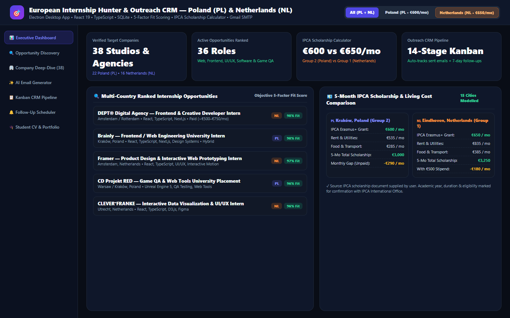

# 🎯 European Internship Hunter & Outreach CRM — Poland (PL) & Netherlands (NL)

[](https://www.electronjs.org/)
[](https://www.typescriptlang.org/)
[](https://www.sqlite.org/)
[_%2B_Netherlands_(NL)-f97316?style=for-the-badge)](#)

> **Author:** Fábio Júnior Fernandes Silva — BSc in Web Multimedia Development @ IPCA (Portugal)  
> **Target Placement Window:** Spring 2027 (February – June 2027, ~4–5 Months)



---

## 🌟 Overview & How It Works

**European Internship Hunter & Outreach CRM** is a multi-process **Windows Desktop Application** built with **Electron**, **React 19**, **TypeScript**, **Tailwind CSS**, and **SQLite**. Originally engineered to discover and manage curricular university internships in **Poland (`PL`)**, it has been extended to fully support **the Netherlands (`NL`)** as a second target country alongside Poland.

### Core Modules & Capabilities

1. **Multi-Country Internship Discovery (`Poland` & `Netherlands`)**:
   - Search and filter verified internship vacancies and high-fit speculative targets across:
     - **Poland (`PL`)**: Kraków, Warsaw, Gdańsk, Wrocław, Poznań
     - **Netherlands (`NL`)**: Amsterdam, Rotterdam, Utrecht, Eindhoven, The Hague, Groningen, Delft, Leiden, Arnhem, Breda
   - Integrates with **Greenhouse**, **Lever**, and **Ashby** public job boards plus verified company career portals.
   -Clearly distinguishes **Confirmed Official Vacancies** vs. **Speculative Applications** and surfaces verified English vs. Dutch/Polish language requirements.

2. **Transparent 5-Factor Fit Scoring Engine (0–100)**:
   - Objectively evaluates Polish and Dutch opportunities without country bias across:
     1. **Degree Relevance** (Web Multimedia Development — max 25 pts)
     2. **Target Role & Sector Match** (Web, Frontend/Backend, UI/UX, Digital Agencies, Software/QA, Game Dev/QA — max 25 pts)
     3. **Location & Financial Feasibility** (max 20 pts)
     4. **Internship Dates & ~5-Month Duration Compatibility** (Feb–Jun 2027 — max 15 pts)
     5. **English-Language Accessibility & International Suitability** (max 15 pts)

3. **IPCA Erasmus+ Scholarship & Living-Cost Comparison Calculator**:
   - Built-in financial planning engine comparing **Poland (`Group 2 — €600/month`)** and **the Netherlands (`Group 1 — €650/month`)** across 15 cities for an ~5-month placement.
   - Models city-specific estimates for rent/accommodation, utilities/internet, food/groceries, public transport, flights from Portugal, and initial housing deposits, plus employer stipends (*stagevergoeding*).

4. **Context-Aware AI Email Generator & Direct Gmail SMTP Dispatch**:
   - Generates tailored English or Portuguese outreach emails referencing verified company products, technologies, and the candidate's live deployed portfolio (**Daymark**, **CineLog**, **StocksVault**, **Retiro Interior**, **ACRIALBI**).
   - Automatically attaches the selected **1-Page Tailored A4 CV** and the **Portfolio Showcase PDF**.
   - Requires explicit human approval before sending via Gmail SMTP (`Nodemailer`), with daily send limits and global pause safety controls.

5. **14-Stage Kanban & Table Application CRM**:
   - Automatically logs and advances companies to **`Email sent`** when an outreach email is dispatched, and schedules a **7-business-day follow-up reminder**.
   - Supports one-click CSV export and `.eml` message archiving.

---

## 🛠️ Tech Stack & Architecture

| Layer | Technology |
| :--- | :--- |
| **Desktop Shell & IPC** | Electron Main + Preload ContextBridge (`contextIsolation: true`) |
| **Frontend UI** | React 19, TypeScript, Tailwind CSS, Lucide Icons |
| **Database** | Local SQLite (`sql.js` / WAL persistence) with safe schema migrations |
| **Job Board Integrations** | Greenhouse API, Lever API, Ashby GraphQL API |
| **Email & PDF Engine** | Nodemailer (Gmail SMTP), Headless Chromium `printToPDF` A4 Generator |

---

## 🚀 Running & Building Locally

```bash
# Install dependencies
npm install

# Run in development mode (Vite + Electron)
npm run dev

# Run the 10-point Poland + Netherlands verification suite
node scripts/seed-netherlands-all-dbs.cjs

# Build renderer and package Windows executable
npm run build:renderer
npx electron-builder --win --dir
```
